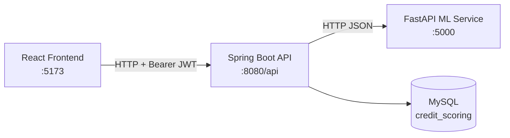

# ClearScore: Explainable AI Loan Eligibility Platform

A full-stack loan eligibility checker that explains every decision. An XGBoost model predicts approval probability, SHAP shows which features drove the result, and every prediction is stored with a tamper-evident audit trail.

**Why:** credit decisions often work as black boxes, so applicants and auditors cannot see why a loan was approved or rejected. ClearScore returns the decision together with the top factors behind it.

**Stack:** React, Vite, Chart.js, Spring Boot, Spring Security, FastAPI, XGBoost, SHAP, MySQL, JWT

> **Status:** working prototype built for learning and demonstration. See [Known Limitations](#known-limitations) before using it for anything real.

---

## Features

- **Explainable predictions:** approval probability, a 0-100 risk score, affordability calculation, and the top 5 SHAP feature attributions per decision
- **JWT authentication:** HS256 tokens with 24-hour expiry, verified by a request filter on protected endpoints
- **User-scoped history:** each user sees only their own past predictions
- **Audit trail:** predictions and SHAP explanations are saved to MySQL, and audit entries are linked by a hash chain so tampering can be detected
- **Dashboard:** three Chart.js visualizations (approval probability, feature importance, prediction history) and a 13-field loan application form

---

## Architecture



| Service | Folder | Responsibility |
|---|---|---|
| Frontend | `FrontEnd/clearscore/` | UI, auth screens, loan form, charts, token storage |
| Backend | `Backend/LMS/proj/` | Authentication, request validation, calling the ML service, persistence, audit log |
| ML service | `Backend/api/` | Feature engineering, XGBoost prediction, SHAP explanations, risk scoring |

### Backend components

| Component | Role |
|---|---|
| `AuthService` | User registration and login, salted SHA-256 password hashing |
| `JwtTokenService` | HS256 token generation and verification |
| `JwtAuthFilter` | Verifies the Bearer token and attaches the user ID to the request |
| `PredictionService` | HTTP client for the Python ML service |
| `LoanController` | REST endpoints for loan predictions and history |

---

## API

### Spring Boot (`http://localhost:8080/api`)

| Method | Endpoint | Auth | Description |
|---|---|---|---|
| POST | `/auth/register` | No | Create an account, returns `userId` and a JWT |
| POST | `/auth/login` | No | Log in, returns a JWT |
| POST | `/loan/apply` | Bearer JWT | Submit an application, returns decision, probability, risk score, and SHAP feature importance |
| GET | `/loan/history/me` | Bearer JWT | List the current user's past predictions, newest first |

### ML service (`http://localhost:5000`)

| Method | Endpoint | Description |
|---|---|---|
| POST | `/predict` | Returns prediction, probability, risk score, and top 5 SHAP features |
| GET | `/health` | Reports whether the model, explainer, and preprocessing are loaded |

---

## How a prediction works

1. The user submits the loan form from the React app with their JWT.
2. `JwtAuthFilter` verifies the token and extracts the user ID.
3. The backend saves the applicant and application records.
4. `PredictionService` sends the loan data to the FastAPI service.
5. FastAPI engineers features, runs the XGBoost model, and computes SHAP values.
6. The backend saves the decision and SHAP explanations to MySQL and appends a hash-chained audit entry.
7. The frontend shows the result with charts and adds it to the user's history.

---

## Getting started

### Prerequisites

- Java 21 and Maven
- Python 3.10+
- Node.js 18+
- MySQL 8

### 1. Database

Create a MySQL database named `credit_scoring`. Hibernate creates the tables on first start. Set your database credentials in the backend's `application.properties`.

### 2. ML service

```bash
cd Backend/api
pip install -r requirements.txt   # or install the dependencies listed in this folder
python -m uvicorn app:app --reload --port 5000
```

Check it: `GET http://localhost:5000/health`

### 3. Backend

```bash
cd Backend/LMS/proj
mvn package
java -jar target/proj-0.0.1-SNAPSHOT.jar
```

### 4. Frontend

```bash
cd FrontEnd/clearscore
npm install
npm run dev
```

Open `http://localhost:5173`, register a new account, and submit a loan application.

---

## Tech stack

| Layer | Technology |
|---|---|
| Frontend | React 18, Vite, Chart.js 4, Axios |
| Backend | Spring Boot 4.0.6, Java 21, Hibernate/JPA, MySQL 8 |
| ML service | FastAPI, XGBoost, SHAP |
| Auth | JWT (HS256), custom implementation |

---

## Known limitations

This is a prototype. These are the gaps I know about:

- **Accounts are stored in memory.** Registered users are lost when the backend restarts, so persisting users in MySQL is the first fix needed.
- **Password hashing is salted SHA-256.** It is fast to brute-force, so it should be replaced with bcrypt or Argon2.
- **The JWT secret is a development value.** It should come from an environment variable, and CORS should be restricted to the frontend origin.
- **No rate limiting** on any endpoint.
- **Model files are static pickles** with no versioning or performance monitoring.
- **Error handling is coarse.** Validation errors and system errors are not clearly separated.
- **Logging is basic** file logging with no structured output.

---

## Roadmap

- [ ] Move users into MySQL with a `password_hash` column, and add refresh tokens
- [ ] Replace SHA-256 with bcrypt or Argon2
- [ ] Move secrets to environment variables and restrict CORS
- [ ] Add rate limiting
- [ ] Version model artifacts and track model performance
- [ ] Add structured logging and metrics
- [ ] Add Docker Compose for one-command startup
- [ ] Add CI with automated tests
